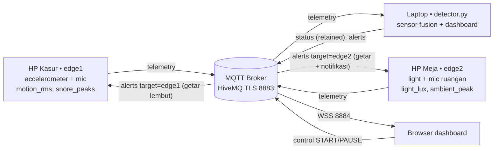

# 😴 Smart Sleep & Snore Guardian

Sistem IoT pemantau kualitas tidur dan dengkuran memakai **2 HP Android sebagai edge device**,
**MQTT over TLS (HiveMQ publik)**, detector di laptop, dan dashboard web live.
Struktur kode mengadaptasi repo referensi `contoh-project-iot1` (PocketGuard).

> Hasilnya adalah **indikasi** dari sensor HP, bukan diagnosis medis atau pengukuran fase tidur.
> **Privasi:** audio tidak disimpan dan tidak dikirim. File rekaman 6 detik dihapus segera setelah
> dihitung level suaranya; yang dipublikasikan hanya angka.

## Ide & masalah
Dengkuran dan tidur gelisah sulit disadari sendiri. HP di bantal/kasur (Edge 1) merasakan getaran dan
suara; HP di meja (Edge 2) merasakan cahaya dan kebisingan ruangan sebagai pembanding. Detector menggabungkan
keduanya dan memicu aksi: bantal bergetar lembut saat mendengkur keras, notifikasi saat tidur buruk.

## Arsitektur


## Kesesuaian dengan ketentuan tugas
| Ketentuan | Di proyek ini |
|---|---|
| 2 edge device | Edge 1 HP kasur (`hp_kasur.py`), Edge 2 HP meja (`hp_meja.py`) |
| 2 sensor | Accelerometer + mikrofon (Edge 1), sensor cahaya + mikrofon (Edge 2) |
| 2 jenis data processing | **Motion RMS** (`motion_rms`) dan **Noise Peak Detection** (`detect_snore_peaks`); tambahan ringkasan cahaya/kebisingan |
| Algoritma | Rule-based sensor fusion + riwayat 5 jendela (`nodes/detector_service/rules.py`) |
| Protokol ke cloud | MQTT over TLS ke `broker.hivemq.com:8883` |
| Dashboard satu jaringan | `detector.py` melayani dashboard di `localhost` laptop (opsional) |
| Aksi | `termux-vibrate` dan `termux-notification` di HP |

## Data processing
| Edge | Sensor | Pengolahan (tiap jendela 6 dtk) | Dikirim |
|---|---|---|---|
| 1 | Accelerometer | `magnitude=√(x²+y²+z²)`; **motion_rms** = simpangan baku magnitudo (dikurangi rata-rata, jadi kemiringan HP tidak dianggap gerak) | `motion_rms` |
| 1 | Mikrofon | RMS per 100 ms → ambang adaptif `max(median×3, 0,02)` → hitung rentetan 0,2–3 dtk di atas ambang = **puncak dengkuran** | `snore_peaks`, `snore_level` |
| 2 | Cahaya | median beberapa pembacaan | `light_lux` |
| 2 | Mikrofon | rata-rata dan puncak level suara ruangan | `ambient_level`, `ambient_peak` |

## Algoritma status tidur
Per jendela: `restless` = motion ≥ 0,2 · `loud` = ada puncak dan level ≥ 0,03 ·
`env_noise` = loud tetapi Edge 2 mendengar level hampir sama (rasio < 1,5; mis. TV/lalu lintas) ·
`snoring` = loud dan bukan env_noise · `bright` = lux ≥ 30.

| Status | Kondisi (5 jendela terakhir) | Aksi |
|---|---|---|
| `POOR_SLEEP_ALERT` | skor ≤ 50 (min. 3 jendela) | Edge 2 getar + notifikasi |
| `HEAVY_SNORING` | ≥ 3 jendela snoring | Edge 1 getar lembut (ganti posisi) |
| `RESTLESS` | ≥ 2 jendela restless | – |
| `ENV_NOISE` | ≥ 2 jendela env_noise | – |
| `DEEP_SLEEP` | selain itu | – |

`sleep_score = 100 − 40·frac(restless) − 35·frac(snoring) − 25·frac(bright)`.
Alert punya cooldown 60 detik per level agar HP tidak bergetar terus.

## Topic MQTT
```text
sleepguard/<PROJECT_ID>/edge/edge1/telemetry   {device_id, boot_id, sequence, sent_at_ms, motion_rms, snore_peaks, snore_level}
sleepguard/<PROJECT_ID>/edge/edge2/telemetry   {…, light_lux, ambient_level, ambient_peak}
sleepguard/<PROJECT_ID>/status    (retained)   {status, reason, monitoring, sleep_score, counts}
sleepguard/<PROJECT_ID>/alerts                 {level, target: edge1|edge2, sleep_score, reason}
sleepguard/<PROJECT_ID>/control                START | PAUSE
```
Detector menolak payload rusak, timestamp basi (> 30 dtk; jam kedua HP harus akurat/otomatis) dan sequence berulang (replay).

## Struktur
```text
detector.py  hp_kasur.py  hp_meja.py        titik masuk 3 node
nodes/detector_service/{main,rules}.py      MQTT detector + algoritma murni
nodes/edge1_bed/  nodes/edge2_table/        entry per node
shared/{sensors,processing,messages,mqtt_connection,edge_runner,alarm,dashboard_server}.py
dashboard/index.html                        dashboard live (MQTT.js via WSS)
scripts/{offline_demo,check_sensors}.py     latihan tanpa broker dan kalibrasi sensor
tests/                                      unit test
```

## Setup
**Laptop:** Python 3.10+
```bash
pip install -r requirements.txt
cp .env.example .env          # ganti PROJECT_ID yang unik
python scripts/offline_demo.py   # coba algoritma tanpa HP/broker
python detector.py               # lalu buka http://localhost:8000
```
**Tiap HP (Termux + Termux:API dari F-Droid):**
```bash
pkg update && pkg install python git termux-api ffmpeg
pip install paho-mqtt python-dotenv
git clone <repo-kamu> && cd <repo-kamu> && cp .env.example .env   # PROJECT_ID sama persis
termux-sensor -l     # pastikan ada Accelerometer (HP kasur) / Light (HP meja)
```
Izinkan **Mikrofon** untuk aplikasi Termux:API di pengaturan Android (juga Notifikasi).

**Jalankan** (urutan bebas): laptop `python detector.py` · HP kasur `python hp_kasur.py` · HP meja `python hp_meja.py`.
Letakkan HP kasur di bawah bantal/dekat kepala, HP meja **menghadap atas** agar sensor cahaya terbuka.

**Tanpa HP (simulator):** `python hp_kasur.py --source simulator --scenario night`
(dan `hp_meja.py` dengan opsi sama). Skenario: `deep snoring restless poor noisy_room night`
(`night` berjalan otomatis 210 dtk: nyenyak → dengkur → gelisah → buruk). Simulator hanya untuk latihan, jangan disebut demo edge fisik.

## Kalibrasi
Angka bergantung HP dan kasur. Jalankan `python scripts/check_sensors.py bed` (diam, lalu berguling/dengkur)
dan `... room`, lalu setel `MOTION_THRESHOLD`, `SNORE_ABS_MIN`, `SNORE_LEVEL_MIN`, `BRIGHT_LUX` di `.env`.
Jika diubah, samakan konstanta di bagian atas script `dashboard/index.html`.

## Pengujian
`python -m unittest discover -s tests -v` (processing, rules, skema pesan, simulator).
Skenario demo manual: (1) HP kasur diam → `DEEP_SLEEP`; (2) putar rekaman dengkuran dekat HP kasur → `HEAVY_SNORING`
+ getar; (3) goyang kasur → `RESTLESS`; (4) goyang + dengkur + senter ke HP meja → `POOR_SLEEP_ALERT`;
(5) putar TV keras dari jauh → `ENV_NOISE`.

## Pemecahan masalah
- *Rekaman kosong / gagal:* cek izin mikrofon Termux:API, `pkg install ffmpeg`, dan tutup aplikasi lain yang memakai mikrofon.
- *Sensor cahaya tidak terbaca:* sensor on-change; ubah pencahayaan sebentar atau coba `termux-sensor -s <nama> -n 1`.
- *`REJECTED_STALE`:* aktifkan waktu otomatis di kedua HP dan laptop.
- Broker publik dipakai bersama: gunakan `PROJECT_ID` unik dan jangan kirim data rahasia.
